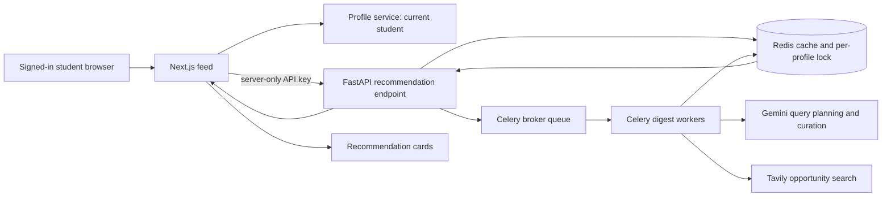

# Personalized Opportunity Recommendations

This document describes the recommendation path shared by the Zigex student app and the AI service. It records the problems addressed, how the current implementation works, and what happens when many students request recommendations together.

## 1. Summary

The student feed now requests recommendations for the signed-in student's current profile instead of relying only on a generic department/location group. The Next.js server checks profile completeness, sends the student's profile fields to the FastAPI service using a server-only API key, and receives either a ready digest, an empty result, or a queued status. Expensive search and language-model work runs in Celery workers and is cached in Redis.

The system has two related but distinct digest paths:

- **On-demand personalized path:** used by the feed. A profile-specific digest is built and cached for one student and one profile version.
- **Scheduled weekly path:** the existing batch job can still fetch many students, group them by department and location, and create one digest for each group. This path is useful for broad weekly delivery, but it is not the path the personalized feed uses.

The implementation queues a burst of 100 requests instead of doing 100 web searches in the web request handlers. The current worker configuration is deliberately conservative, however; it smooths the burst rather than completing all 100 recommendations immediately.

## 2. Issues Addressed

### 2.1 Local frontend-to-AI configuration was ambiguous

The frontend and AI service use different environment variables for different connections. Treating them as one URL/key pair caused local requests to target the wrong service or fail API-key authentication.

Resolution:

1. `AI_SERVICE_URL` in the Next.js server identifies the AI service base URL. The local launcher sets it to `http://127.0.0.1:8000`.
2. `AI_SERVICE_API_KEY` is a server-only secret. The local launcher reads `API_KEY` from the sibling AI service's `.env` and passes it to Next.js; the key is sent to FastAPI as `x-api-key` and is never exposed to browser code.
3. `ZIGEX_API_URL` is an AI-service setting for the scheduled bulk job. It must identify the paginated Zigex student API endpoint that `fetch_profiles()` reads. It is not the URL of the AI service and is not required by the on-demand path, because that path receives the current student's profile in the request body.
4. The AI service rejects requests without the matching API key through `require_api_key`.

Relevant files: `scripts/dev-local-ai.mjs`, `lib/api/ai-service.ts`, `app/config.py`, and `app/security.py` in the respective repositories.

### 2.2 Recommendations could be shared at too broad a level

The batch pipeline groups profiles by department and location. A group digest is useful for a scheduled newsletter, but using it as the only feed lookup can make different students receive the same recommendations even when their skills and interests differ.

Resolution:

1. The Next.js server obtains the authenticated student's profile through `getMyProfile()`.
2. It extracts the student's department/field of study, skills, interests, level, and location.
3. It calls `POST /v1/digests/student/{student_id}/recommendation` with the student ID in the path and profile attributes in the body.
4. The AI service normalizes the profile and creates a stable profile-specific segment ID from a SHA-256 hash of the student ID and profile attributes. The raw profile values are not used as the Redis key.
5. A changed department, skills, interests, level, or location produces a different profile hash, so stale recommendations for the previous profile are not treated as this profile's result.

The previous grouped batch route remains available; it is separate from the feed's per-student route.

### 2.3 Zigex profile fields did not map consistently to AI fields

The frontend profile schema and AI service schema use different field names, and profiles may be nested. Reading only a single name such as `department` or `skills` could silently drop valid profile information.

Resolution:

1. `Profile.from_dict()` accepts nested profile objects and known aliases such as `field_of_study`, `fieldOfStudy`, `track`, `hard_skills`, `soft_skills`, and `preferred_industries`.
2. It de-duplicates normalized skills and interests before using them in the digest segment.
3. The frontend maps the current profile into a consistent request shape before calling the AI service.
4. The feed requires a department, at least one skill, and a location before requesting personalized recommendations. An incomplete profile returns a `profile-needed` UI state instead of asking the AI service to guess.

The profile CTA leads to `/dashboard/edit-profile`, where the saved profile is loaded into the edit form. Signed-out users are redirected to sign-in with that route as the return destination.

### 2.4 External search and generation should not hold open a page request

Finding opportunities requires query planning, web search, curation, and validation. Those operations can take many seconds and depend on external Gemini and Tavily services. Running them synchronously in the feed request risks timeouts and makes the experience brittle.

Resolution:

1. FastAPI checks Redis for a completed digest for the current week and profile hash.
2. If there is no completed result, FastAPI enqueues `build_student_digest` in Celery and immediately returns `202` with `status: queued`.
3. The worker plans queries, searches the web, curates a limited set of source-backed items, validates URLs and dates in code, and stores the result in Redis.
4. The feed renders a preparing state while the result is queued. `RefreshWhilePreparing` refreshes the server-rendered state every 12 seconds for up to 10 attempts; once the digest is ready, the same request returns it from cache.
5. Empty results and unavailable service states are represented separately so that “still working,” “no matching results,” and “service unavailable” are not shown as the same error.

### 2.5 Duplicate requests could queue duplicate AI work

Several renders or repeated page refreshes can ask for the same student's current digest while the first job is still running.

Resolution:

1. Before enqueueing, the API attempts a Redis `SET ... NX` lock keyed by week and profile-specific segment ID.
2. The lock has a five-minute expiry as a recovery mechanism if a worker dies before cleanup.
3. A request that cannot acquire the lock returns `queued` instead of scheduling another task.
4. If enqueueing fails, the API releases the lock before returning an error.
5. The Celery task releases the lock when its attempt finishes; digest cache entries outlive the lock and prevent repeating completed work.

This is duplicate suppression, not exactly-once execution. A crash or retry can still repeat external work, so task code should continue to be idempotent and should tolerate provider retries.

### 2.6 Celery needed to load the digest task module

The API and worker both need the digest task definitions registered. Importing the API route alone is not a robust way to ensure every worker process discovers every task.

Resolution: `app/worker/celery_app.py` explicitly includes both `app.worker.tasks` and `app.worker.digest_tasks`. The Compose worker starts the digest task app with concurrency set to two.

### 2.7 The feed did not make profile completion and recommendations clear

An incomplete profile previously led to a generic or empty-looking state. The feed also felt too narrow, and recommendation controls were visually mixed with the regular opportunity board.

Resolution:

1. The feed shows a dedicated profile-needed section with a clear profile completion action.
2. Three blurred cover images sit behind skeleton placeholders to preview the card layout without pretending the student already has personalized results.
3. The recommendations and open opportunities remain separate sections, each with its own category filter and loading control.
4. The content shell was widened for desktop and constrained responsively for smaller screens.
5. Recommendation cards use opportunity-style covers and metadata. Summaries are clamped to one line, with a Read more/Read less control for longer text.

### 2.8 More recommendations have a premium prompt, but payment is not integrated

The Load more recommendations action opens the 3,000 XAF monthly Pro dialog. Its current payment action opens an email to Zigex support; it does not yet create a payment session, verify payment, or attach a subscription entitlement to the student's account. The price and dialog are a product prompt, not a complete billing system.

## 3. Current System Design

Qdrant is part of the AI service's separate course-document search/RAG path. The current opportunity digest path uses Gemini, Tavily, Celery, and Redis; it does not retrieve opportunity cards from Qdrant.

### Request lifecycle

1. A signed-in student opens `/feed`. The feed renders `RecommendedPicks` only for authenticated users.
2. `loadMyDigest()` runs on the Next.js server and deduplicates calls during the current render using React `cache()`.
3. It reads the current student's profile. If the required fields are missing, no AI request is sent and the profile-needed preview is rendered.
4. Otherwise, `getStudentRecommendation()` sends the profile to the AI service from server-only code. It uses `AI_SERVICE_URL`, attaches `x-api-key`, and uses a bounded request timeout.
5. The FastAPI route builds the profile hash and checks `digest:{week}:{profile_segment}` in Redis.
6. If the digest is cached, FastAPI returns `ready` or `empty`. Otherwise it acquires `digest_student_lock:{week}:{profile_segment}` and queues a Celery task. Duplicate callers receive `queued` while that lock exists.
7. The worker invokes the digest agent. It builds search queries from department, location, level, skills, and interests; searches with Tavily; asks Gemini to curate a bounded list; and validates source IDs, dates, duplicates, and URLs before saving.
8. The next server refresh reads the cached digest and renders recommendation cards. If the job remains queued, the UI continues its bounded refresh loop.

The AI prompt receives normalized profile attributes that influence relevance, not the student's name, email, or browser session. The student's ID is used for the API/cache association; the `Segment.public()` representation excludes the list of student IDs.

### Scheduled batch path

The separate weekly `digest.run_weekly` path can fetch paginated student records using `ZIGEX_API_URL`, normalize them with `Profile.from_dict()`, and group them by department and location. Small location groups are merged into department-wide groups. Each group is built once and may be pushed to students through the configured Zigex webhook. This path optimizes broad weekly delivery; it should not be confused with the feed's per-student request.

## 4. What Happens With 100 Students at Once?

Assume 100 students open the feed at roughly the same time and each has a complete profile.

1. The Next.js layer makes up to 100 lightweight recommendation requests. Each is tied to the current student ID and profile hash.
2. FastAPI checks Redis. Existing cached results are returned without creating new AI work.
3. For uncached results, Redis locks suppress duplicate requests for the same student/profile/week. Different students have different hashes, so up to 100 distinct jobs can be enqueued.
4. The API returns `queued` without waiting for web search or LLM generation. Redis and Celery absorb the burst.
5. The current Docker Compose worker runs one worker service with `--concurrency=2`. The student digest task also has a Celery `rate_limit="6/m"`. With one worker instance, that rate limit can cap the drain rate to roughly six such tasks per minute. A 100-task backlog can therefore take on the order of 17 minutes or longer to drain, depending on task time, retries, provider quotas, and worker rate-limit scope.
6. Each student sees a preparing state until a later refresh finds the cached digest. Because the current browser refresh loop ends after ten 12-second attempts, a long queue can outlast the UI's automatic refresh window. A student can refresh manually, but this is a known production-scale UX gap.

So the design resolves request-time overload by queueing and deduplicating expensive work, not by promising that 100 AI jobs finish simultaneously. The worker settings are the throughput control.

### Scaling options

For a 100-student burst, first measure average task time, provider quotas, queue wait time, Redis memory, and cost per digest. Then scale in this order:

1. Increase Celery worker replicas and concurrency only within Gemini/Tavily quotas. All workers must share the same Redis broker/cache. The task's `6/m` rate limit is a worker-side control; multiple workers can multiply aggregate provider traffic, so a cluster-wide provider quota needs a distributed limiter if required.
2. Keep the API stateless and add API replicas behind a load balancer if request volume requires it. Redis locks and cached digests remain the shared coordination layer.
3. Replace repeated POST-as-polling with a task/status endpoint keyed by task ID or profile hash. Poll with backoff and continue for the actual queue SLA; avoid stopping refresh while work is still queued.
4. Add queue-age, task-duration, retry, provider-error, cache-hit, and lock-contention metrics. Alert on queue age and provider failures, not only API health.
5. For sustained high volume, separate opportunity discovery from personalization: periodically harvest and verify a shared catalog of opportunities, then use a fast per-student eligibility filter/ranker over that catalog. Cache the ranked result per profile version. This retains personal matching while avoiding a fresh web-search/LLM pipeline for each of 100 students.
6. Add automated unit tests for field normalization, profile-hash stability/change, cache hits, duplicate locks, task failure cleanup, and source/date validation, plus an integration test that submits many profiles and observes queue/cache behavior.

The shared-catalog design is a future scale improvement, not the current implementation. It also introduces a freshness tradeoff: discovery happens on a schedule, while per-student ranking can happen immediately.

## 5. Tradeoffs and Remaining Work

- **Personalization vs cost:** current profile-specific generation avoids serving one generic digest to everyone, but has much higher external API usage than one shared segment digest.
- **Freshness vs speed:** generating from live search can discover new opportunities but takes longer and depends on third parties. A shared catalog can make ranking faster but needs a reliable refresh pipeline.
- **Caching vs profile changes:** the profile hash prevents reusing a digest after a profile change; old digests remain until their Redis TTL expires, which is bounded but consumes storage.
- **Queue wait UX:** the current ten-refresh limit may be shorter than a 100-job queue. A proper job-status endpoint and backoff policy should replace repeated recommendation POST requests.
- **Payment:** the Pro dialog is not a verified billing flow yet; payment provider integration, webhook verification, entitlement storage, and access checks are still required.
- **Next.js security reminder:** `experimental.agentUpgrade: false` disables upgrade reminders only. It does not patch Next.js. The installed version reported a security advisory during development, so the dependency upgrade remains a separate security task.
- **Testing:** local synthetic-profile and service checks were used during development. A signed-in browser test with a real profile and a repeatable 100-profile queue test should be added before treating the full load behavior as certified.

## 6. Source Map

Frontend repository:

- `lib/api/services/digest.ts` - profile loading, required fields, state mapping.
- `lib/api/ai-service.ts` - server-only AI-service client, API-key header, recommendation endpoint.
- `components/digest/RecommendedPicks.tsx` - profile-needed state and recommendation section.
- `components/digest/RecommendationBrowser.tsx` - filters, cards, summary expansion, and load-more prompt.
- `components/digest/RefreshWhilePreparing.tsx` - bounded refresh while a task is queued.
- `app/(public)/feed/page.tsx` - feed composition and wide layout.

AI service repository (`zigex-ai`):

- `app/api/digests.py` - batch and per-student API endpoints.
- `app/core/profiles.py` - profile normalization and segment identity.
- `app/core/digest_store.py` - Redis digest cache, mapping, and locks.
- `app/worker/digest_tasks.py` - weekly and per-student Celery work.
- `app/worker/celery_app.py` - task module registration.
- `app/core/digest_agent.py` - query planning, search, curation, and validation.
- `docker-compose.yml` - current API, Redis, Qdrant, and worker topology.